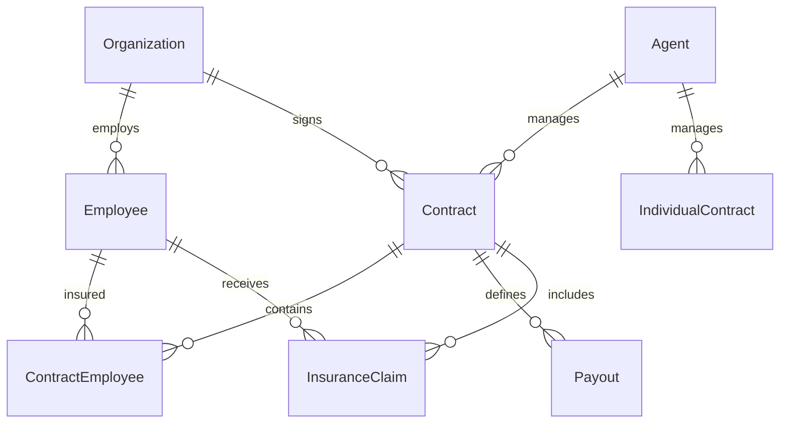

# Проектирование и материалы для отчёта

## Сценарии

Пользователь выбирает вкладку, просматривает таблицу и открывает форму добавления или редактирования. Удаление требует подтверждения. Для коллективного договора выбираются организация, агент и сотрудники, вводятся даты и суммы категорий. Для отчёта задаются дата и при необходимости код организации; результаты выводятся в таблицу с прокруткой.

## Связи данных

Основные таблицы: `Organization`, `Employee`, `Agent`, `Contract`, `ContractEmployee`, `Payout`, `IndividualContract`, `InsuranceClaim`. Первичные и внешние ключи определены в `models/database.py`; проверка внешних ключей включается при каждом подключении.

Триггеры устанавливаются при инициализации базы. Они запрещают включать в договор сотрудника другой организации, менять организацию сотрудника или договора в нарушение существующих связей, сохранять договор с датой окончания раньше даты начала и менять страховую компанию агента, если за ним есть договоры. Проверка календарной корректности дат остаётся в Python. Триггеры проверяют новые и изменяемые записи; уже существующие записи автоматически не исправляются.

## Отчёты

SQL-запросы находятся в `models/contract.py`. Они связывают договор с организацией, агентом или суммами категорий, фильтруют даты условием `conclusion_date <= ? AND end_date >= ?`. Для списка агентов применяется `DISTINCT`. Отчёт по категориям сохраняет номер договора и не складывает разные суммы.

## Материалы для скриншотов

Главное окно с вкладками, таблицы организаций и сотрудников, форма коллективного договора, таблица страховых случаев, каждый из трёх отчётов. Средства разработки: Python, SQLite, стандартные модули sqlite3, tkinter/ttk, unittest.
